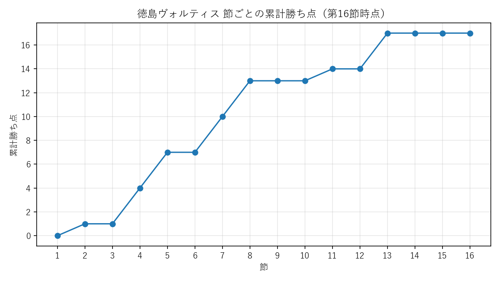

# 徳島ヴォルティス 試合結果スクレイピング

Jリーグ公式サイト（jleague.jp）の試合ページから、J2リーグの試合結果（スコア・得点者・得点時間）を集め、SQLiteデータベースに保存するPythonプログラムです。保存したデータは、SQLで成績や得点者を集計し、matplotlibでグラフにできます。個人の学習プロジェクトとして作成しました。



第16節時点（2026-27シーズン）の、徳島ヴォルティスの節ごとの累計勝ち点です。データの取得からグラフの作成まで、すべてこのリポジトリのプログラムで行っています。

## できること

- `match_list.txt` に書いた試合を、Jリーグ公式サイトから順に取得する
- 各試合のページから、シーズン・節・試合日・対戦カード・スコア・得点者・得点時間を取り出す
- 取り出したデータを、SQLiteデータベース（`data/vortis.db`）に保存する
  - `matches` テーブル：1試合＝1行
  - `goals` テーブル：1得点＝1行（両チームの得点者）
  - `fixtures` テーブル：J2の対戦表（まだやっていない試合も含む）
- SQLで、勝敗・得点者ランキング・試合ごとの得点一覧・節ごとの勝ち点などを集計する
- 節ごとの累計勝ち点を、折れ線グラフ（PNG）にする

## 処理の流れ

```text
main.py
 ├─ match_list.txt を読む（試合の一覧）
 ├─（保存済みの試合は、ここで飛ばす）
 ├─ fetch_jleague.py … 試合ページを取得し、データを取り出す
 │                     （試合が終わっていない試合は保存しない）
 └─ save_data.py     … matches と goals にまとめて保存する
                          ↓
                    data/vortis.db
                          ↓
make_graph.py … queries/points_by_section.sql の結果をグラフにする
                          ↓
             output/points_by_section.png
```

## 必要なもの

- Python 3.9以上
- requests、matplotlib（下の「準備」で入れます）
- 集計に使う場合：SQLiteのコマンドラインツール（sqlite3）。[SQLite公式サイト](https://www.sqlite.org/download.html)から入手できます

## 準備

リポジトリのフォルダで、必要なライブラリを入れます。

```text
pip install -r requirements.txt
```

データベース（`data/vortis.db`）は公開していません。下の `python main.py` を実行すると、`data/` フォルダとテーブルが自動で作られます。

## 実行方法

### 1. 試合データを集める

```text
python main.py
```

`match_list.txt` に書いた試合を取得して保存します。試合が終わったら、`match_list.txt` に1行足して、もう一度実行します。保存済みの試合は取得せずに飛ばすので、新しい試合だけが追加されます。

`match_list.txt` は1行に1試合、「年 番号」の形（例：`2026 102412`）で書きます。空行と `#` から始まる行は読み飛ばします。書き方がおかしい行があると、サイトに1回もアクセスせずに止まります。

### 2. グラフを作る

```text
python make_graph.py
```

`output/points_by_section.png` に、節ごとの累計勝ち点のグラフを保存します。データベースがない、データが0行、節の順番がおかしいときは、グラフを作らずに止まります。

### 3. 対戦表を作る（任意）

```text
python update_fixtures.py        … 必要な試合を全部見に行く
python update_fixtures.py 3      … 試しに3試合だけ見に行く
```

Jリーグ公式サイトの試合ページ一覧（match.xml）から、J2の全試合の対戦表（`fixtures` テーブル）を作ります。最後に、徳島の終わった試合を `match_list.txt` と見比べて表示します（答え合わせ）。

- `main.py` とは別に動きます。試合データを集めるだけなら、実行しなくてかまいません
- 初回は約380試合のページを2秒おきに取得するため、10分以上かかります
- `queries/tokushima_fixtures.sql` を使うには、先にこれを実行しておく必要があります

### 4. SQLで集計する

SQLiteのコマンドラインツール（sqlite3）で行います。

```text
sqlite3 data/vortis.db
.headers on
.mode column
.read queries/win_draw_lose.sql
```

### テスト

次の4つです（サイトにも本物のデータベースにもアクセスしません）。

```text
python test_fetch_jleague.py
python test_parse_fixture.py
python test_save_data.py
python test_main_errors.py
```

## ファイル構成

- `main.py`：全体の流れをまとめる司令塔スクリプト
- `match_list.txt`：取得する試合の一覧（1行1試合。例：`2026 102412`）
- `fetch_jleague.py`：試合ページを取得し、ページに埋め込まれたデータからスコア・得点者などを取り出す
- `save_data.py`：取り出したデータを、SQLiteの `matches`・`goals`・`fixtures` に保存する（テーブルがなければ作る）
- `update_fixtures.py`：match.xml からJ2の試合番号を集めて、対戦表（`fixtures`）を作る・新しくする
- `make_graph.py`：節ごとの累計勝ち点を折れ線グラフにして保存する
- `requirements.txt`：必要なライブラリの一覧
- `test_fetch_jleague.py`：保存済みの試合ページで `fetch_jleague.py` を確かめるテスト（普通・オウンゴール・0-0・アディショナルタイムの4試合）
- `test_parse_fixture.py`：保存済みの試合ページで、対戦表用の `parse_fixture` を確かめるテスト
- `test_save_data.py`：使い捨てのデータベースで `save_data.py` を確かめるテスト
- `test_main_errors.py`：1試合で失敗したときの `main.py` の動きを確かめるテスト
- `save_test_html.py`：テスト用の試合ページを保存する（最初の1回だけ）
- `queries/`：集計用のSQLファイル
  - `win_draw_lose.sql`：徳島の勝ち・分け・負けの数、得点・失点・勝ち点
  - `top_scorers.sql`：徳島の得点者ランキング（オウンゴールは除く）
  - `tokushima_goals.sql`：徳島の得点を試合ごとに一覧にする（`goals` と `matches` をJOIN。オウンゴールは「（OG）」付き）
  - `tokushima_fixtures.sql`：徳島の対戦表（`fixtures` を使う）
  - `points_by_section.sql`：節ごとの勝ち点と累計（グラフの元データ）
- `output/points_by_section.png`：`make_graph.py` が作ったグラフ
- `docs/decisions.md`：設計で決めたこと・確認したことの記録
- `NEXT.md`：次にやること・ロードマップ

## テーブル設計

**matches**（1試合＝1行）

| 列 | 内容 |
|---|---|
| game_id | 試合ID（主キー）。試合日の年＋Jリーグ公式の番号（例：2026102412） |
| season | シーズン（例：2026-27） |
| section | 節（例：13） |
| match_date | 試合日（YYYY-MM-DD） |
| home_club / away_club | ホーム / アウェイのチーム名 |
| home_score / away_score | ホーム / アウェイの得点 |

**goals**（1得点＝1行）

| 列 | 内容 |
|---|---|
| game_id | どの試合か（`matches` とつなぐ鍵。外部キー） |
| club | 得点が入ったチーム（オウンゴールも、得点が入ったチーム） |
| scorer | 得点者 |
| minute / added_time | 得点した分 / アディショナルタイム（例：90+6' → 90 と 6） |
| is_own_goal | オウンゴールなら 1 |

**fixtures**（対戦表。J2の1試合＝1行。まだやっていない試合も含む）

| 列 | 内容 |
|---|---|
| game_id | 試合ID（主キー。`matches` と同じ作り方） |
| season / section | シーズン / 節 |
| match_date / kickoff | 試合日 / キックオフ時刻 |
| home_club / away_club | ホーム / アウェイのチーム名 |
| game_type | 試合の状態（終わった試合は post-game） |
| checked_at | 最後に確認した日時 |

## 工夫したところ

- **重複して保存しない**：`game_id` を主キーにしているため、同じ試合を何度実行しても二重に保存されません。`match_list.txt` に同じ試合を2回書いても、2回目は飛ばします。
- **保存済みの試合はページを取りに行かない**：実行前にデータベースを確認し、新しい試合だけを取得します。公式サイトへのアクセスを最小限にするためです。
- **終わっていない試合は保存しない**：試合ページの状態が「試合終了」のときだけ保存します。
- **中途半端に保存しない**：1試合ぶんの `matches` と `goals` は、まとめて保存します。途中で失敗した場合は、どちらにも保存されません。
- **おかしなデータは保存しない**：チームごとの得点者の数がスコアと合わない試合は、保存せずに止めます。
- **表記をそろえる**：チーム名の全角英字（例：横浜ＦＣ）を半角にそろえてから保存します。
- **対戦表は上書きで新しくする**：同じ試合をもう一度確認したときは、試合日や状態を上書きします。延期で日程が変わっても、古い情報が残りません。
- **1試合の失敗で全体を止めない**：取得に失敗した試合は飛ばして次へ進み、最後にまとめて表示します。失敗した試合は次の実行でもう一度取りに行きます。
- **確かめてから使う**：普通・オウンゴール・0-0・アディショナルタイムの試合でテストし、作り直したデータベースは手で集めたスコアと突き合わせて確認しました。グラフも、最後の値がSQLの累計勝ち点と一致することと、データが0行のときに止まることを確かめています。

## 公式サイトの利用について

- robots.txt と利用規約を確認したうえで取得しています（2010〜2019年の試合ページは robots.txt で取得禁止のため対象外）。
- 取得するのは、スコア・対戦カード・得点者・得点時間などの試合の事実のみです。公式サイトの文章・写真・画像・デザインは保存・公開していません。
- 集めたデータベースと、取得したページのHTMLは公開していません（`.gitignore` で除外）。
- ページの取得ごとに2秒の間隔を空け、サーバーに負担をかけないようにしています。

## 今後の予定

`NEXT.md` のロードマップに沿って、1つずつ進めます。

- `main.py` を対戦表（`fixtures`）で動かし、`match_list.txt` への手書きをなくす
- 徳島以外のJ2のチームの試合結果も集める
- SQLで自作の順位表を作る
- 得点時間帯の分布など、グラフを増やす

## 使用技術

- Python 3.9以上
- requests（Webページの取得）
- re / json / xml.etree.ElementTree（ページや一覧に埋め込まれたデータの取り出し）
- SQLite（データの保存・集計。Python標準の `sqlite3` モジュールを使用）
- matplotlib（グラフの作成）

## 学習メモ

最初は徳島ヴォルティス公式サイト（vortis.jp）から集め、CSVに保存していました。その後、保存先をSQLiteに移し、得点者を別のテーブルに分けて、JOINで組み合わせて集計する方法を学びました。

徳島以外のチームのデータにも広げるため、取得元をJリーグ公式サイトに一本化し、データベースを作り直しました。設計で決めたことは `docs/decisions.md` に残し、次の日はそれを前提に作業を始めるようにしています。
